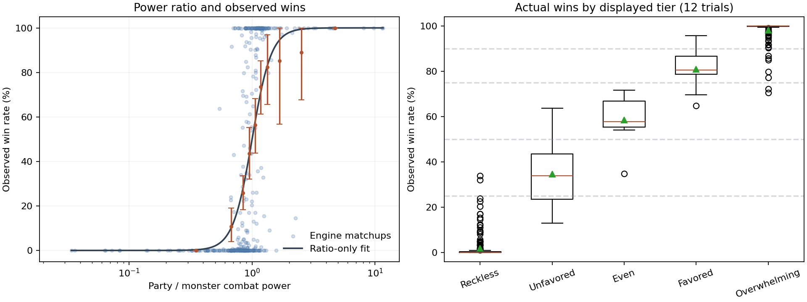

# Arche 016 전투·전투력 검수

1. **진행 난도가 목표에 못 미쳤다.** 출전 가능한 386일 중 접전 또는 우세 리프트가 있던 날은 182일(47.2%, 95% 구간 39.6–54.5%)이었다. 015 목표는 80%다.
2. **비슷한 전투력도 승률은 크게 갈렸다.** 365개 조합을 2,000회씩 돌렸다. 전투력 비율만 쓴 승률 모델은 검증 표본에서 평균 26.2%p 틀렸다.
3. **전투력과 위험도에 정합성 오류가 있다.** 아군 전체 체력 특성을 반영한 파티 전투력은 832인데 표시 계산은 826이었다. 특성만 바뀌면 위험도 캐시가 이전 단계를 돌려줄 수 있다.
4. **판정 순서와 방어 분리는 통과했다.** 2,000개 시드에서 결과 JSON이 바이트 단위로 같았다. 치명타 피해율의 전투 상한은 현재 빠져 있다.
5. **가장 큰 개선은 전투력의 용도와 리프트 공급을 함께 조정하는 것이다.** 예산을 모두 지키는 가중치 후보로 오차를 23.0%p까지 줄일 수 있었다. 위험도는 실제 모의 전투를 유지하고, 중간 난도 공급은 별도 실험한다.

- 날짜 및 검수자　2026-11-24 KST · Codex
- 종류 및 심각도　전투·밸런스 검수 · 진행 목표 미달 높음, 확인된 개별 오류 중간
- 위치　`src/engine/combat.ts`, `stats.ts`, `combatPower.ts`, `src/data/{stats,traits,combat-power,rift-tiers,roster}.json`
- 설계서 근거　[설계서 §3·§5·§7–8](../design/phase1-spec.md), [015 §0·§3](../tasks/015-mid-difficulty.md), [016 §2·§4–6·§8](../tasks/016-stats-traits.md), [계약자 30명 초안](../design/roster-stats-draft.json)

## 방법과 재현

검수 대상은 016 구현 `6e0704c`를 포함한 `56c1b75`다. 검수 중 016이 main에 합쳐졌고 두 커밋의 `src/`와 `scripts/`는 같다. 비교는 016 직전 `6835ead`와 검수 착수 당시의 `origin/main` `59b19ec`로 고정했다. 전투 규칙 비교에서는 두 이전 기준의 승수와 결과가 일치했다. 진행 비교에서는 015 리프트 변형이 있는 `6835ead`가 016만의 영향을 보는 기준이다.

| 항목 | 표본과 대조 |
|---|---|
| 결정성·정합성 | 2,000개 시드. 전투 리턴값 전체를 UTF-8 JSON 바이트로 비교. RNG는 독립 대조 수열 30,000회와 실제 첫 타격 2,000회로 확인 |
| 전투력·위험도 | 등급별 합법 레벨 73조합 × 파티 크기 5 = 365개. 조합당 실제 승률 2,000개 시드와 별도 위험도 시드 96개(앞 12·48·96회). 전투력 분석 274개 학습, 91개 검증 |
| 역할·계약자 | Lv1·15·30·50에서 6×6 방향성 1대1 및 대칭 1대1·3대3 미러 각 6개씩, 총 192개. 계약자 30명은 Lv15·35에서 빼기와 동일 역할 교체의 쌍대 실험, 총 120개 대조 |
| 민감도·특성 | 능력치 변화 44개와 상성·방어 조합 18개. 특성은 60개 데이터 행에서 66개 A/B, 슬롯 7개에 28개 대조. 모든 대조군과 실험군에 같은 2,000개 시드 사용 |
| 전후·진행 | 기본 `balance` 45개 구성마다 전후 2,000회. 각 버전 서울 개방자 10개 시드 × 60일, 기존 자동 플레이 정책과 이동·마감 검사 적용 |

전투력 표본은 30명에서 중복 없이 뽑고 성장 한계 안에서 개별 레벨을 생성했다. 4/5는 비슷한 레벨·인원대에 가깝게 층화했고 나머지는 한계 내에서 넓게 뽑았다. 몬스터는 해당 등급이 허용하는 종만 사용했다. 이는 설계 검수 표본이며 라이브 플레이 빈도 추정에는 별도 표본이 필요하다. 역할전은 기본 열·공허 대 공허·기본 스탯·특성 없음으로 고정했다. 계약자 교체 대조군은 같은 역할·레벨·속성인 역할 기준 유닛이다. A/B 일부는 승패가 갈리도록 검수용 상대를 사전 시드 18개로 고정했다. 본 실험은 다른 시드를 썼으며, 이 실험용 중급 적 탐색에는 실제 생성 범위 밖 레벨도 허용했다.

개별 승률은 Wilson 95%, A/B는 같은 시드의 승패 차에 대한 95% 구간이다. 뒤집힌 판이 6개 미만이면 각각의 Wilson 구간으로 보수적으로 계산했다. 전후 비교는 난수 스트림 자체가 바뀌어 두 승률의 Wilson 구간을 결합했다. 전투력 오차는 조합 단위, 진행은 같은 플레이의 여러 날이 서로 영향을 받으므로 플레이 시드 단위로 4,000회 복원 추출했다. 각 표·CSV의 구간은 다중 비교를 보정하지 않았다.

실행 환경은 Node 24.22.3, npm 11.19.1, tsx 4.23.15, TypeScript 5.9.3, Vitest 5.1.1이다. 권장 버전인 Node 22.23.5에서도 `npm test` 332개와 핵심 검수를 확인했다. 이전 main은 294개 통과했다. 현재 저장소와 검수 스크립트의 타입 검사도 통과했다. `npm run sim/balance/days`에서 이 환경의 tsx CLI 소켓 생성이 차단되어, 같은 스크립트를 `node --import tsx`로 호출했다. 검수 자료 기록에는 Node의 표준 파일 API를 사용했다. [Node.js 22 공식 문서](https://nodejs.org/docs/latest-v22.x/api/fs.html)

```sh
npm ci
npm test
npm run typecheck
node --import tsx scripts/sim.ts arche-review 15 mid
node --import tsx scripts/balance.ts 2000
node --import tsx scripts/days.ts 60 days
node --import tsx scripts/difficulty-stats.ts 60 10

git worktree add --detach ../arche-before 6835ead
git worktree add --detach ../arche-main 59b19ec
audit=docs/reviews/data/combat-power-2026-11-24/audit.ts
out=docs/reviews/data/combat-power-2026-11-24
for stage in core roles members sensitivity traits; do
  node --import tsx "$audit" "$stage" 2000 "$out"
done
for grade in low mid high extreme; do
  node --import tsx "$audit" power 2000 "$out" "$grade" 0
done
node --import tsx "$audit" compare 2000 "$out" ../arche-before parent
node --import tsx "$audit" compare 2000 "$out" ../arche-main main
node --import tsx "$audit" days 10 "$out"
node --import tsx "$audit" days 10 "$out" ../arche-before
node --import tsx "$audit" days 10 "$out" ../arche-main
node --import tsx "$audit" days-proposal 10 "$out"
python3 "$out/analyze.py"
```

그래프 재생성에는 NumPy 2.3.5와 Matplotlib 3.10.8을 사용했다. 시드 규칙, 조합 ID, 승·패·철수 건수, 대조 간 뒤집힌 건수를 CSV에 남겼다. 수십만 건의 로그는 스크립트와 집계량으로 재현할 수 있다. 진행의 시작 상태는 [v8 세이브](data/combat-power-2026-11-24/repro-save.json)로도 열 수 있다.

## 1. 결정성·정합성 결과

| 검사 | 결과 |
|---|---|
| 동일 입력과 시드의 결과 JSON 바이트 | 차이 **0/2,000**. 입력 변경도 0. 로그에 회피 1,090·치명타 4,011·치유 8,483건 포함 |
| 피해 변동 → 회피 → 치명타 | 독립 난수 수열 대조 **0/30,000** 불일치. 회피·치명이 0이거나 상한일 때도 상태 같음. 첫 타격의 피해와 판정 **0/2,000** 불일치 |
| 물리·에너지 방어 분리 | **0/4,000** 불일치. 해당 방어만 올렸을 때 첫 피해가 줄고 반대 방어 변경에는 동일 |
| 치유 | 치명타율·피해율 대조 **0/2,000** 불일치. 치유 직전 명중을 고정한 회피율 대조 **0/1,024** 불일치 |
| 상한 | 치명타율 0.80, 회피율 0.50, 특성 스탯 합 +0.50, 피해·치유 +0.60, 받는 피해 감소 0.40 통과. 치명타 피해율 상한 누락 |
| 데이터 정합성 | 초안 30명 스탯과 특성 슬롯 이름의 전사 오류 0. 특수 스탯 7종 모두 비활성 |

2,000회 중 차이가 0건이었던 검사에서 실패율의 Wilson 95% 상한은 0.19%다. 난수 순서를 확인한 단위는 타격이다. 스탯 때문에 적이 일찍 쓰러지거나 행동 순서가 바뀌면 그 뒤 실제 타격 수나 난수를 쓰는 주체는 달라질 수 있다. [핵심 검사 CSV](data/combat-power-2026-11-24/checks.csv)

## 2. 전투력과 실제 승률



전투력 비와 승률의 전체 Pearson은 **0.361**이고, 로그 전투력 비는 **0.506**이었다. 로그 비로 추정한 승률의 검증 표본 Pearson은 **0.634**, 평균 절대오차는 **26.17%p**(95% 구간 21.68–30.74), RMSE는 **33.99%p**다. 365개 중 135개는 2,000회 모두 실패했고 81개는 모두 승리했다. 실제 승률 10–90%인 구성은 59개다.

| 아군/몬스터 전투력 비 | 조합 | 실제 평균 승률, 95% 구간 | 모형 평균 | 구성별 평균 절대오차 |
|---|---:|---:|---:|---:|
| 0.50 미만 | 42 | 0.005% (0.000–0.013) | 0.5% | 0.5%p |
| 0.50–0.75 미만 | 52 | 10.8% (3.9–19.0) | 9.7% | 16.6%p |
| 0.75–0.90 미만 | 89 | 25.8% (18.3–33.6) | 27.3% | 31.0%p |
| 0.90–1.00 미만 | 47 | 43.5% (32.0–55.3) | 42.8% | 36.2%p |
| 1.00–1.10 미만 | 47 | 56.4% (43.8–68.3) | 57.4% | 39.8%p |
| 1.10–1.25 미만 | 45 | 73.6% (61.2–85.2) | 70.6% | 37.6%p |
| 1.25 이상 | 43 | 세부 구간 평균 82.5–100.0% | 82.9–100.0% | 0.01–25.1%p |

비슷한 2인 파티끼리도 차이가 컸다. 하급 Lv5 잠식 포자 둘을 상대하는 전술가 둘(m30·m20 Lv1)은 전투력 비 **1.035**, 승률 **0%**였다. 최상급 Lv51 공동의 전령 둘을 상대하는 저격수·투사(m08 Lv50·m16 Lv53)는 **1.041**, **100%**였다. 5인에서도 **1.027의 0.55%**와 **0.987의 95.60%**가 있었다. 비가 0.90–1.25일 때 평균 승률은 1인 41.8%, 2인 46.8%, 3인 58.7%, 4인 81.8%, 5인 59.4%였다. 인원별로 역할 분포와 적 구성이 달라 직접적인 인원 효과로 해석할 수 없다. [구성별 표본](data/combat-power-2026-11-24/) · [비율 구간](data/combat-power-2026-11-24/power-bins.csv) · [인원별 오차](data/combat-power-2026-11-24/power-party-size.csv)

### 가중치 탐색

각 항목을 기본값의 0.50·0.75·1.00·1.25·1.50으로 하나씩 바꿨다. 공격쌍은 1.50배에서 검증 MAE 22.91%p, 방어쌍은 0.50배에서 22.63%p였다. 체력은 0.50배에서 24.89%p, 물리공격은 1.50배에서 24.36%p였다. 단독 속도 계수 변화는 26.1–26.3%p, 치명타 기댓값 26.0–26.3%p, 회피 기댓값 26.1–26.2%p로 설명력 차이가 작았다. 상대 행동 순서를 넘는 속도 효과와 전열 회피 효과는 아래 통제 실험에서 따로 확인했다.

| 모델 | 체력 | 물공·에공 | 물방·에방 | 속도 | 검증 MAE / Pearson | Lv1 예산 |
|---|---:|---:|---:|---:|---:|---|
| 현재 | 0.25 | 2.0·2.0 | 1.5·1.5 | 1.0 | 26.17%p / 0.634 | 98.19–102.07%, 위반 0명 |
| 공격·방어 및 보조 항 별도 탐색 | 0.125 | 3.0·2.5 | 0.75·0.75 | 0.50 | 18.32%p / 0.769 | 91.96–110.91%, 위반 7명 |
| 현재 JSON에 적용 가능, 예산 제한 | **0.1875** | **2.50·2.50** | **1.50·1.125** | **1.25** | **22.99%p / 0.694** | **95.37–104.65%, 위반 0명** |

제한 후보의 검증 오차 개선은 **3.18%p**(95% 구간 2.11–4.26)였다. 별도 탐색은 물리·에너지 치명타 기댓값 계수 3.0, 회피 기댓값 0.375까지 바꿨다. 주로 방어를 과대평가하고 실제 사용하는 공격을 과소평가하는 방향이 보인다. 단일 역할 합산 수치에서는 전술가 둘처럼 피해를 낼 역할이 부족한 편성이나, 공격을 오래 버텨야 강해지는 지원 조합의 기여가 뭉친다. 제약 후보도 전열 보호, 아군 특성, 적 수, 공격 유형과 행동 순서 차이를 설명하지 못한 오차가 남았다. 비율 0.90–1.25에서 단독 수호자 5개는 평균 60.8%p 과대평가됐고 단독 투사 8개는 27.6%p 과소평가됐다. 2인 이상에서는 저격수 포함 57개가 22.5%p, 투사 포함 57개가 15.5%p 과소평가됐다. 이 편성들은 역할이 겹치고 개별 표본이 작아, 효과 방향을 확인하는 자료로 사용했다. [역할별 예측 오차](data/combat-power-2026-11-24/power-by-role.csv) · [단일 항목 격자](data/combat-power-2026-11-24/weight-grid.csv) · [모델별 비교](data/combat-power-2026-11-24/weight-models.csv)

### 위험도 5구간

게임의 예상 위험도는 전투력 비율을 구간으로 바꾸는 방식 대신 보이는 정보로 모의 전투를 돌린다. 아래는 적 정보를 정확히 아는 조건에서 시드 수의 영향만 따로 검사한 표다. 경계는 `0.90/0.75/0.50/0.25/0`이다.

| 12회 표시 | 조합 | 실제 승률 평균 | 실제 승률 10/50/90 분위 | 같은 구간 |
|---|---:|---:|---:|---:|
| 압도 | 124 | 98.0% | 93.5/100.0/100.0% | 117/124 |
| 우세 | 10 | 80.9% | 69.0/80.5/90.7% | 6/10 |
| 접전 | 9 | 58.5% | 50.2/57.8/69.6% | 8/9 |
| 열세 | 23 | 34.6% | 18.3/33.9/53.4% | 13/23 |
| 무모 | 199 | 1.8% | 0.0/0.0/5.0% | 197/199 |

12회 추정의 단계 일치율은 **341/365(93.4%)**, 48회는 **347/365(95.1%)**, 96회는 **356/365(97.5%)**였다. Wilson 95% 구간은 각각 90.4–95.5%, 92.3–96.9%, 95.4–98.7%다. 압도와 무모가 다수를 차지한다. 12회로 중간 구간이라 표시한 19개 중 실제 접전·우세는 **16개(84.2%, 95% 구간 62.4–94.5)**로, 경계 재조정에는 표본이 작다. 현행 12회에서 압도는 11승, 우세는 9–10승, 접전은 6–8승이다. 구간별 평균은 각 구간 안에 들어오지만, 특히 열세·우세 근처에 있는 개별 조합의 표시는 흔들렸다. [위험도별 분포](data/combat-power-2026-11-24/risk-calibration.csv)

## 3. 역할·계약자·전투 길이

Lv30 1대1 승률(%)이다. 행이 아군이며, 아군에만 구성 계수 0.85가 붙는 현재 PvE 규칙을 썼다. 열의 순서는 행과 같다.

| 공격 측 | 수호자 | 투사 | 저격수 | 마도사 | 사제 | 전술가 |
|---|---:|---:|---:|---:|---:|---:|
| 수호자 | 0.0 | 0.0 | 0.0 | 0.0 | 0.0 | 0.0 |
| 투사 | 100.0 | 5.0 | 2.0 | 64.2 | 100.0 | 100.0 |
| 저격수 | 100.0 | 41.0 | 35.6 | 92.2 | 100.0 | 100.0 |
| 마도사 | 100.0 | 0.8 | 0.2 | 38.1 | 100.0 | 100.0 |
| 사제 | 0.0 | 0.0 | 0.0 | 0.0 | 0.0 | 21.8 |
| 전술가 | 0.0 | 0.0 | 0.0 | 0.0 | 0.0 | 0.0 |

대칭 미러의 1대1 승률은 다음과 같다. 미러끼리는 양쪽 구성 계수를 같게 두었다.

| Lv | 수호자 | 투사 | 저격수 | 마도사 | 사제 | 전술가 |
|---|---:|---:|---:|---:|---:|---:|
| 1 | 0.0% | 51.1% | 50.4% | 50.4% | 0.0% | 0.0% |
| 15 | 0.0% | 50.8% | 51.0% | 49.4% | 0.0% | 0.0% |
| 30 | 0.0% | 49.8% | 50.5% | 49.3% | 0.0% | 0.0% |
| 50 | 0.0% | 48.5% | 48.6% | 49.5% | 0.0% | 0.0% |

대칭 1대1에서 수호자·사제·전술가 미러는 거의 전부 철수했다. 대칭 3대3에서도 수호자·사제는 모두 철수했고 전술가는 Lv별 24.4–25.4% 철수했다. PvE 규칙의 역할 대전 288,000판 중 61,907판(21.5%)이 철수였다. 무작위 PvE 730,000판에서는 15라운드 도달 21,156판(2.90%), 철수는 20,066판(2.75%)이었다. 15라운드에 승패가 나면 해당 결과를 내고, 그때도 승패가 없으면 설계서 §5대로 철수한다. 역할 고유 기능은 파티에서 확인해야 한다. [네 레벨의 전체 승률표와 구간](data/combat-power-2026-11-24/roles.csv)

### 계약자 30명

단위는 승률 변화 %p다. **추가**는 같은 3인 파티에 넣었을 때, **교체**는 동일 역할·레벨·속성인 역할 기본값 유닛을 바꿨을 때의 변화다. 30명 모두 Lv1 예산 95–105% 안이다.

| 계약자 | 예산 | Lv15 추가 | Lv15 교체 | Lv35 추가 | Lv35 교체 |
|---|---:|---:|---:|---:|---:|
| m01 강태산 | 100.37% | +60.80 | +29.70 | +70.70 | +40.35 |
| m02 쿠로세 렌 | 100.24% | +68.70 | +27.05 | +83.75 | +18.65 |
| m03 마야 참 | 99.85% | +44.70 | +16.85 | +85.40 | +37.50 |
| m04 윤서아 | 100.80% | +61.75 | +25.05 | +83.10 | +21.75 |
| m05 오진석 | 98.19% | +80.85 | +49.75 | +89.30 | +58.95 |
| m06 신지호 | 100.03% | +45.55 | +11.05 | +69.50 | +5.15 |
| m07 백서린 | 100.53% | +42.60 | -1.55 | +67.00 | -3.05 |
| m08 타치바나 아키라 | 100.56% | +53.20 | +11.55 | +75.15 | +10.05 |
| m09 다니엘 브루크스 | 99.84% | +83.30 | +43.50 | +96.75 | +40.65 |
| m10 임소하 | 101.27% | +80.50 | +19.95 | +96.90 | +14.95 |
| m11 모리타 겡지 | 102.07% | +40.10 | +9.00 | +48.20 | +17.85 |
| m12 카게야마 쇼 | 101.29% | +37.70 | +3.20 | +64.80 | +0.45 |
| m13 미야자와 유우 | 100.24% | +68.70 | +27.05 | +84.75 | +19.65 |
| m14 시라유키 하루카 | 101.27% | +56.00 | +19.30 | +79.90 | +18.55 |
| m15 빅토리아 레이놀즈 | 100.04% | +84.60 | +43.95 | +93.45 | +18.50 |
| m16 마도현 | 99.75% | +59.85 | +25.35 | +87.50 | +23.15 |
| m17 구만수 | 102.07% | +40.10 | +9.00 | +61.50 | +31.15 |
| m18 미겔 오르티스 | 100.85% | +65.90 | +24.25 | +86.40 | +21.30 |
| m19 나카무라 사에 | 99.85% | +55.05 | +15.25 | +79.00 | +22.90 |
| m20 카를로스 멘도사 | 101.91% | +46.05 | +1.90 | +82.05 | +12.00 |
| m21 토니 루소 | 100.03% | +45.55 | +11.05 | +83.50 | +19.15 |
| m22 마커스 홀리스 | 100.46% | +13.55 | +7.45 | +22.25 | +16.40 |
| m23 제이 박 | 100.85% | +65.90 | +24.25 | +84.00 | +18.90 |
| m24 루시아 페르난데스 | 101.38% | +64.05 | +27.35 | +89.95 | +28.60 |
| m25 아오키 미츠키 | 99.84% | +83.30 | +43.50 | +95.00 | +38.90 |
| m26 유도진 | 100.53% | +42.60 | -1.55 | +73.85 | +3.80 |
| m27 타카기 다이치 | 99.75% | +62.05 | +27.55 | +90.60 | +26.25 |
| m28 안예린 | 100.89% | +55.30 | +15.50 | +92.55 | +36.45 |
| m29 올리버 그레이 | 101.27% | +56.00 | +19.30 | +75.05 | +13.70 |
| m30 하야시 켄타로 | 101.66% | +42.30 | +1.65 | +80.90 | +5.95 |

Lv35 수호자 자리에서는 **오진석 89.3%와 마커스 홀리스 22.3%**가 나왔다. 예산은 각각 98.19%, 100.46%다. 역할 기본값 대비로도 +58.95%p와 +16.40%p였다. 빛과 공허가 서로 1.3배인 차이가 포함된 결과이므로 이 격차 전부를 체력이나 회피로 돌릴 수 없다. 같은 조건에서 수호자 체력·회피를 단독으로 바꾼 결과는 아래 표에 있다. 전술가 순위도 영향을 받았다. Lv15 백서린·유도진은 역할 기준 대비 −1.55%p였지만 투입 효과는 둘 다 +42.60%p였다. 실험에서 추가 투입 효과가 음수인 계약자는 없었다.

같은 역할에서 9개 기본 스탯이 모두 같거나 우위이고 그중 하나가 엄격히 높은 조합은 없었다. 반면 **기본 스탯이 완전히 같은 그룹이 9개**다. 그중 m03·m19는 Lv15까지 기본 스탯과 공통·역할 특성이 같다. 속성과 이후 배경·고유 특성이 차이를 만든다. 개별 계약자의 교체 효과가 상대와 편성 전반에서 유지되는지는 추가 표본이 필요하다. [30명 대조군별 승수·95% 구간](data/combat-power-2026-11-24/members.csv)

### 단독 민감도, 극단치, 상성

Lv25 혼합 파티에서 한 명만 바꾼 승률 변화다. 같은 시드를 사용했다.

| 한 가지 변경 | 수호자 | 저격수 | 마도사 | 사제 |
|---|---:|---:|---:|---:|
| 치명타율 +10%p | +0.45 | +4.75 | +5.30 | +0.50 |
| 치명타 피해율 +25%p | 0.00 | +1.70 | +1.05 | +0.10 |
| 회피율 +5%p | +11.50 | +3.50 | +3.85 | +1.00 |
| 체력 ×1.10 | +18.50 | +5.10 | +6.40 | +2.25 |
| 물리·에너지 방어 각각 ×1.10 | +3.80 | +0.35 | +0.20 | 0.00 |
| 속도 하한 ×0.80 | 0.00 | −14.95 | 0.00 | +19.15 |
| 속도 상한 ×1.25 | −0.30 | +14.05 | +13.45 | +18.35 |

수호자에 회피 +5%p는 자신의 전투력 **+1.27%**에 승률 **+11.50%p**(95% 구간 10.00–13.00)를 줬다. 방어쌍 +10%는 전투력 **+4.53%**에 승률 **+3.80%p**(2.65–4.95)였다. 저격수 속도 상한은 전투력 +1.50%에 승률 +14.05%p(11.12–16.98)였고, 사제 속도 하한도 +19.15%p(16.43–21.87)였다. 선턴으로 공격을 먼저 넣거나, 아군이 맞은 뒤에 치유할 수 있게 되는 순서 변화의 영향을 받았다. 속도 하나의 선형 계수로 양쪽 효과를 표현하기 어렵다.

방어의 0.70/1.40 극단치와 속도 0.80/1.25 극단치에서도 15라운드 철수는 사제 실험에서만 관찰됐다. 2,000전 중 기준 44판(2.20%), 속도 하한 37판(1.85%), 상한 40판(2.00%)이었다. 사제 평균 라운드는 9.07 → 9.09/9.22였다. 수호자 물리방어를 하한/상한으로 조정하면 승률 −7.15/+10.10%p, 평균 8.67 → 8.55/8.82라운드였고 이 표본의 철수는 0판이었다. 방어와 속도의 변경별 라운드 및 철수 수는 원자료에 있다. 속성 상성은 물리·에너지 모두 물리 또는 에너지 방어로 깎은 피해에 곱해졌다. 유리·중립·불리의 수치를 그대로 사용했다. 마도사 중립전에서 에너지방어 0.70 → 1.40은 첫 피해 평균을 102.42 → 92.82, 승률을 57.15% → 27.40%로 낮췄다. 기본 방어에서 상성을 바꾸면 첫 피해가 유리 127.50, 중립 98.07, 불리 73.56으로 갈렸고 승률은 각각 100%, 34.35%, 0%였다. 투사도 중립 물리방어 0.70 → 1.40에서 승률 44.30% → 10.60%였다. 상대 피해도 반대 방향의 상성 배율을 받는다. [단독 민감도](data/combat-power-2026-11-24/sensitivity.csv) · [상성 교차표](data/combat-power-2026-11-24/elements.csv)

### 016 전후 비교

`npm run balance`와 동일한 45개 구성에서 승률 차의 점추정이 ±5%p를 벗어난 구성은 **0개**다. 가장 차이가 컸던 구성은 아래와 같다. 단, 구간 끝이 ±5%p 밖까지 닿는 점은 구별해야 한다. 최상급 Lv1·10·30처럼 일부는 표준 도구의 인위적 비교 행이며, 실제 최상급 생성 레벨은 50–70이다.

| 구성 | 이전 | 이후 | 차이와 95% 구간 |
|---|---:|---:|---:|
| Lv70, 최상급 ×4 | 24.85% | 20.05% | −4.80%p (−7.38–−2.21) |
| Lv10, 최상급 ×4 | 23.80% | 19.35% | −4.45%p (−6.99–−1.90) |
| Lv30, 최상급 ×4 | 16.60% | 19.95% | +3.35%p (+0.95–+5.74) |
| 시작 3인 Lv5, 하급 Lv12 ×3 | 42.60% | 40.30% | −2.30%p (−5.35–+0.75) |

Lv30 최상급 ×4에 대해 사용자가 이미 허용한 예외는 400개 시드에서 +7.2%p였던 행이다. 이번 2,000개 시드에서는 +3.35%p였다. 표준 도구는 역할 기본값으로 합성한 유닛을 쓰므로 개별 계약자 특성으로 인해 생기는 격차는 별도 문제다. [사용자 결정](../open-questions.md) · [016 직전 대조 CSV](data/combat-power-2026-11-24/before-after-parent.csv) · [착수 시 main 대조 CSV](data/combat-power-2026-11-24/before-after-main.csv)

## 4. 특성 A/B와 슬롯 성장

각 특성을 한 명에게 단독 적용했다. 60개 중 57개는 30명 중 실험 가능했다. 56개는 실제 장착자에게, 미배정 공통 특성인 민첩은 허용되는 계약자에게 실험했다. 생존 본능·잡다한 경험·계승의 의지는 현재 허용되는 계약자가 0명이다. 속성 조건이 있는 특성은 별도 상성 대조도 추가했다.

| 순위 | 특성, 검사 계약자 | 공허 대조 승률 | 증가와 95% 구간 |
|---:|---|---:|---:|
| 1 | 대지의 힘, 타카기 다이치 | 36.50% → 57.75% | +21.25%p (19.30–23.20) |
| 2 | 지켜내는 자, 오진석 | 31.40% → 49.90% | +18.50%p (16.57–20.43) |
| 3 | 노련한 지휘, 카를로스 멘도사 | 44.25% → 61.35% | +17.10%p (14.34–19.86) |
| 4 | 용병단의 규율, 마도현 | 39.55% → 53.55% | +14.00%p (12.35–15.65) |
| 5 | 응급 대응, 다니엘 브루크스 | 68.30% → 82.10% | +13.80%p (11.76–15.84) |
| 6 | 깊은 이해, 안예린 | 65.05% → 78.70% | +13.65%p (11.84–15.46) |
| 7 | 도시의 방위, 유도진 | 41.50% → 54.60% | +13.10%p (11.16–15.04) |
| 8 | 응급 처치, 마야 참 | 53.45% → 65.20% | +11.75%p (9.95–13.55) |
| 9 | 강건함, 강태산 | 45.20% → 56.85% | +11.65%p (9.89–13.41) |

공허전에서 승률 변화가 0이었던 11개에는 화염·냉기·대지·전격·바람·어둠 친화와 공명, 적응력, 서리의 결정이 포함된다. 예를 들어 전격 친화는 공허전 0.0%p, 냉기 대조에서는 **+4.55%p**였다. 적응력은 공허전 0.0%p, 화염 계약자가 냉기를 상대하면 **+2.75%p**였다. 끈기는 해당 파티에서 0.0%p였으며 8라운드 이후 발동하는 특성이므로 장기전 수치가 따로 필요하다. 레벨과 상대가 달라 순위는 전체 편성에서의 보편적 우위로 읽기 어렵다. [승률 변화순 전체 특성표](data/combat-power-2026-11-24/traits-ranked.csv)

특성 합산 +0.50 상한에 실제로 잘리는 유형은 물리공격이었다. 전체 30명에게 최대 레벨에서 각 525개 상황을 대입했을 때 카게야마 쇼는 399개, 마도현은 154개에서 잘렸다. 다른 계약자와 다른 적용 중인 상한은 이 상황망에서 잘리지 않았다. 카게야마 쇼는 투지 +0.20, 폭주 +0.30, 연마된 솜씨 +0.05를 합쳐 평상시에도 +0.55까지 간다. 마도현은 기본 배경·역할과 저체력 특성이 함께 걸릴 때 잘린다. 모든 조건이 발생 가능한지를 본 상황망은 동일 가중치이며, 게임에서의 실제 빈도와는 구분한다. 별도 2,000전의 최대 레벨 공허 대조에서는 카게야마 쇼가 **272판(13.6%, 12.2–15.2)·273/4,985타**, 마도현이 **136판(6.8%, 5.8–8.0)·150/7,079타**에서 상한에 닿아 실제 증가분이 잘렸다. 상대는 실험용 레벨을 사용했다. [상황망](data/combat-power-2026-11-24/trait-caps.csv) · [전투 내 상한](data/combat-power-2026-11-24/trait-caps-in-fights.csv)

| 해금 Lv | 도달 계약자 | 두 표본의 레벨업 승률 변화 | 그중 새 슬롯 단독 효과 |
|---:|---:|---:|---:|
| 5 | 30 | +8.65 / +18.50%p | +2.15 / +11.15%p |
| 15 | 30 | +13.05 / +15.50%p | +4.70 / +9.50%p |
| 25 | 30 | +6.15 / +11.30%p | 0.00 / +2.60%p |
| 35 | 30 | +9.45 / +15.50%p | +2.80 / +7.45%p |
| 45 | 26 | +5.50 / +8.20%p | 0.00 / 0.00%p |
| 55 | 14 | +3.70 / +8.05%p | +0.40 / +0.65%p |
| 65 | 5 | +3.45 / +15.40%p | +1.45 / +8.55%p |

Lv5 강태산의 강건함은 새 슬롯 단독으로 **+11.15%p**(95% 구간 9.36–12.94), Lv15 쿠로세 렌의 선제 사격은 **+9.50%p**(8.21–10.79), Lv65 카게야마 쇼의 강건함은 **+8.55%p**(7.20–9.90)였다. 이 시기 일부 캐릭터의 체감 성장 폭이 클 수 있다. Lv45의 두 표본은 화염·냉기 친화여서 공허전에서 발동하지 않았다. 슬롯당 두 명만 정밀 비교했으므로 도달 인원 전원의 급등 빈도는 아직 모른다. [성장 단계 대조](data/combat-power-2026-11-24/unlocks.csv)

## 5. 진행 루프와 표시

서울 개방자 자동 진행을 같은 10개 시작 시드로 60일씩 돌렸다. 출전 가능 인원이 있는 날을 분모로 삼았다. 리프트는 이동 후 도착일이 마감 안인 것만 평가했다. 목록 실제 난도 열은 015의 기존 측정대로 실제 적을 12회 모의한 구간이다. 화면 열은 탐지소에 보이는 정보를 사용했다. 표시 확정은 범위 양 끝이 모두 승률 50% 이상 90% 미만인 접전·우세 안에 있는 날이다. 가능한 날은 표시 범위가 그 두 단계와 교차하는 날도 포함한다.

| 버전 | 실제 편성으로 접전·우세 있는 날 | 95% 구간 | 화면에서 확정 / 가능 | 실제 복귀 성공률 | 부상 발생 복귀 | 부상 계약자·일 |
|---|---:|---:|---:|---:|---:|---:|
| 착수 당시 main | 144/421 (34.2%) | 28.1–40.2% | 59 / 195일 | 365/393 (92.9%) | 43/393 (10.9%) | 324 |
| 016 직전 | 168/368 (45.7%) | 40.4–50.3% | 90 / 232일 | 296/337 (87.8%) | 76/337 (22.6%) | 497 |
| 016 이후 | **182/386 (47.2%)** | **39.6–54.5%** | **109 / 259일** | **314/354 (88.7%)** | **74/354 (20.9%)** | **406** |

016 이후 화면에서 확정은 28.2%, 범위 교차까지 포함하면 67.1%다. 실제 적을 쓴 5,586개 리프트·일 중 31개(0.55%)에서 실제 적의 12회 모의 단계가 화면 추정 범위를 벗어났다. 편성 가능 인원별 목표 달성은 **1–2명 4/56(7.1%)**, **3–4명 46/112(41.1%)**, **5명 이상 132/218(60.6%)**였다. 같은 날 여러 구간이 같이 뜰 수 있다. 목록에 단계가 한 곳 이상 있던 날은 압도 339일, 우세 107일, 접전 115일, 열세 125일, 무모 385일이다.

복귀 성공률 88.7%의 Wilson 95% 구간은 85.0–91.6%, 부상 발생률 20.9%는 17.0–25.4%다. 같은 시드에서 부상 합계는 233건에서 205건으로 줄었다. 자동 진행은 가장 레벨이 낮은 거점 리프트 위주로 출발한다. 화면에서 공략할 수 있는 조합과 자동 정책이 고른 조합이 다를 수 있으며, 복귀 성공률이 높아도 중간 난도 선택지가 적을 수 있다. `difficulty-stats`는 평가 시점에 편성이 가능했던 일부 출발만 세며, 위 표의 복귀 집계는 같은 날 출발·복귀까지 포함했다. [시드별 진행 요약](data/combat-power-2026-11-24/days-summary.csv) · [화면 위험도와 실제 적 대조](data/combat-power-2026-11-24/day-rifts-after.csv)

**소규모 하급 균열 후보를 적용한 대조**. 기존 중급 소규모는 유지하고 하급 Lv6–15, 적 1–2명, 가중치 2 행을 검수 중에만 추가했다. 같은 10개 시드에서 접전·우세가 **218/406일(53.7%, 95% 구간 45.3–62.2)**로 증가했다. 기준 대비 **+6.54%p**이지만 시드 짝을 맞춘 95% 구간은 **−1.61–+15.37%p**다. 가용 1–2명은 12/54일(22.2%), 복귀 성공 336/373(90.1%), 부상 복귀 63/373(16.9%), 부상 계약자·일 408이었다. 이 후보 단독으로 80%를 맞추지는 못했다. [후보별 600일 원자료](data/combat-power-2026-11-24/days-small-low.csv)

## 발견한 오류

| 심각도 | 위치와 근거 | 기대 및 실제 | 재현 |
|---|---|---|---|
| 중간 | `src/engine/combatPower.ts:24–30`, 전투 `combat.ts:193–207`. 016 §4·§8 및 §6 아군 효과 | 전투 시작 상황을 함께 쓰면 아군의 체력 특성이 파티원에게도 반영된다. 표시식은 자기 자신이 내는 특성만 전달해 826을 계산한다. 전투와 같은 시작 상태의 832보다 6 낮다. | `core 2000`의 `power_party_aura`. Lv35 전술가 `unique_m26`와 수호자. 체력 특성 +5% |
| 중간 | `src/engine/combatPower.ts:95–107`. 016 §4·§8 특성 포함 예상 위험도 | 특성 ID·단계가 키에 없다. 동일 스탯에 집중력 +5%를 추가한 다음 조회하면 무모가 남고, 새 테이블 객체로 캐시를 비우면 열세가 나온다. 현재 레벨업은 레벨도 바뀌므로 이 사례는 같은 레벨 컨텍스트를 다시 평가할 때 재현된다. | `core 2000`의 `risk_cache_trait_key`. 시드 `power:cache:15:84:0–11`, 아군 Lv15 마도사 에너지공격 84, 중급 Lv15 균열 술사 둘 |
| 중간 | `src/data/stats.json:53–56`, `src/engine/stats.ts:185–189`. 016 §2·§8의 치명타 피해율 상한 검증 및 이번 검수 요구 | 역할 생성 경계 1.3–1.8은 있다. 최종값에 적용되는 상한 키는 치명타율과 회피율뿐이다. 직접 넣은 치명타 피해율 10.00이 그대로 반환됐다. | `core 2000`의 `critDmg_cap`. 테스트 유닛 최종 스탯 호출에서 재현 |

세 오류는 순수 엔진 호출로 재현되므로 세이브가 필수는 아니다. 진행 재현에는 [검수 세이브](data/combat-power-2026-11-24/repro-save.json)와 위 서울 시드를 사용한다. 015 진행 목표 미달은 **높음**으로 기록한다. 가용 인원에 따라 난도 선택지가 부족하게 공급되는 측정 결과이며, 현재 설정만으로 달성 여부를 판정했다.

## 문서 공백

- **치명타 피해율의 전투 상한 숫자**. 016은 치명타 피해율과 상한 검증을 요구하지만 치명타 피해율의 전투 상한 수치를 정하지 않았다. 기본 스탯 범위의 1.8과 최종 상한을 구분하고, 데이터 타입과 검증에 상한 키를 명시할 필요가 있다.
- **특성 시점과 효과 범위**. 016 효과 목록만으로 끈기와 적응력을 표현하기 어려워 구현에서 `fromRound`와 `disadvantage`를 추가했다. 치유 특성의 저체력 기준은 치유 대상이다. 파티 체력 특성 부여자가 쓰러진 뒤, 이미 적용한 최대 체력을 유지하는 현재 동작도 문서에 정해야 한다.
- **전투력의 단위와 비교 규칙**. 016은 전투 시작 시점의 파티 전체 효과, 조건부 치유·피해 배율, 한쪽만 쓰는 공격 스탯을 점수에서 어느 정도 평가할지 정하지 않았다. 위험도는 모의 전투를 쓰고 있으므로 파티 전투력이 예산·표시에서 어떤 의미를 갖는지 별도로 명시할 수 있다.
- **세이브 번호 중복**. 016은 v7을 적었고, 015가 이미 v7을 사용해 구현은 v8이다. 이전 세이브를 거절하고 형식 변경 시 버전만 높인다는 저장소 규칙과 구현은 일치한다. 지시서 번호만 최신 상태와 맞춰야 한다.
- **계약자·특성 활용 범위**. 단계 1의 몬스터는 공허지만 여러 특성이 다른 속성을 전제로 한다. PvE 1단계에서 활용처가 생길 때까지 테마를 유지할지, 임시 효과를 데이터로 별도 둘지 결정이 필요하다. 지원 역할 1대1과 철수 결과를 경쟁 콘텐츠에서도 같은 규칙으로 둘지는 아직 기준이 없다.

## 개선안

016 §2에는 보존 기준 이후 추가 밸런스 조정을 하지 않는다는 범위가 있고, 016 §5에는 30명 초안 수치를 검수자가 바꾸지 않는다는 규칙이 있다. 아래 스탯·특성 숫자는 후속 패치 후보로만 제시한다. 015 경계와 단계 1 공허 속성, 설계서 §5의 15라운드 철수, 016의 해금 레벨은 후보 실험에서도 유지했다.

| 우선순위 | 근거 수치 | 제안값 및 위치 | 부작용 | 구현 난이도 |
|---|---|---|---|---|
| P1 · 파티 전투력 정합성 | 아군 체력 +5% 증례에서 826 → 832 | 파티 전체의 시작 특성을 사용. `traits.json` `unique_m26`의 `value: 0.05`를 검증 기준으로 유지 | 아군 효과 특성이 있는 편성의 전투력 표시가 올라감 | 낮음 |
| P1 · 위험도 캐시 | 무모 → 열세 증례 1개 | 위험도 키에 활성 `traits`의 ID·단계와 스킬 ID 포함. `combat-power.json` 경계는 `[0.90,0.75,0.50,0.25,0]` 유지 | 동일 조합을 가리키는 키가 길어짐 | 낮음 |
| P1 · 치명타 피해율 상한 | 입력 10.00이 그대로, 현재 계약자 최대 효과 합산 1.75 | `stats.json` `caps.critDmg: 2.0`; `crit: 0.8`, `eva: 0.5` 유지 | 현재 30명에는 절단 없음. 이후 장비·강화의 치명타 피해율 중첩은 제한 | 낮음 |
| P1 · 접전 공급 | 후보 47.2 → 53.7%, 가용 1–2명 7.1 → 22.2% | 기존 소규모 균열과 분리해 실험. `rift-tiers.json`의 검수 후보로 균열에 `id: "small_low"`, `weight: 2`, `monsterGradeWeights: {"low": 1}`, `monsterLevel: [6,15]`, `enemyCount: [1,2]`. 갈리는 지역에는 상위 균열·하위 관문을 유지 | 짧은 편성에 선택지가 늘었으나 +6.54%p의 95% 구간이 0을 포함함. 부상 계약자·일 406 → 408. 합격선은 그대로 80% | 낮음 |
| P2 · 전투력 가중치 | 검증 MAE 26.17 → 22.99%p, 예산 위반 0명 | `combat-power.json` `statWeights: {"hp":0.1875,"pAtk":2.5,"eAtk":2.5,"pDef":1.5,"eDef":1.125,"spd":1.25}`. 예산 `[0.95,1.05]`와 치명·회피 기댓값 산식 유지 | 역할 기준 전투력과 표시 순위가 바뀜. 현재 사용하지 않는 공격 유형도 점수에 남고 역할별 별도 검증 필요 | 낮음 |
| P2 · 위험도 표본 | 12 → 96회에서 단계 일치 341 → 356/365, 48회는 347/365 | `combat-power.json` `simulations: 96`을 비교 대상으로 삼고 경계는 유지. 모바일 지연이 크면 시작값 12회, 재계산 96회의 데이터 키 도입을 후속으로 검토 | 최대 모의 호출 8배. 이 검수에서는 모바일 프레임 시간 미측정. 흐린 몬스터 정보 자체는 그대로 | 중간 |
| P3 · 큰 체력 특성 | 대지의 힘 단독 +21.25%p, 지켜내는 자 +18.50%p, Lv5 강건함 +11.15%p | `traits.json` 체력 효과 `unique_m27` 0.08 → **0.06**, `unique_m05` 0.10 → **0.08**, `sturdy` 0.06 → **0.04**를 각각 재검수 | 현행값에서 후보값으로 바꾼 A/B는 각각 **−2.80, −3.55, −3.50%p**. 강건함은 여러 계약자와 7번 슬롯에도 영향을 줌 | 낮음 |
| P3 · 물리공격 특성 상한 | 카게야마 쇼 272/2,000전에서 +0.50 상한이 증가분 제한 | `traits.json` `unique_m12` 누적 `max: 0.25` 후보. `perRound: 0.06`와 `caps.statMulMax: 0.50` 유지 | 투지·연마를 함께 활성화한 일반 조건에서는 합이 +0.50. 고유 특성 단독 또는 예외 조합은 약해짐. 이 후보 자체의 승률 A/B는 미측정 | 낮음 |
| P3 · 속도와 단계 1 특성 | 저격수 속도 상한 +14.05%p, 사제 하한 +19.15%p. 전격 친화 공허 0.00%p, 냉기 +4.55%p | `stats.json` `roleBounds.spd: [0.80,1.25]` 유지. `traits.json` `unique_m20` 속도 0.04 → 0.03은 표본에서 승률 변화 0.00%p여서 보류. `affinity_*` 초기값 0.08 유지 및 실제 발동률 표시 후 재측정 | 속도는 행동 순서가 바뀌는 경계에서 급변한다. 공허 한정 임시 효과를 추가하면 속성별 개성과 이후 확장 밸런스에 영향 | 중간 |

[특성 후보의 시드별 쌍대 요약](data/combat-power-2026-11-24/trait-proposals.csv) · [재현 스크립트](data/combat-power-2026-11-24/audit.ts) · [통계·그래프 스크립트](data/combat-power-2026-11-24/analyze.py)
